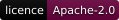

<p align="center">
  <picture>
    <source media="(max-width: 600px) and (prefers-color-scheme: light)" srcset=".github/assets/banner-phone-light.svg">
    <source media="(max-width: 600px)" srcset=".github/assets/banner-phone.svg">
    <source media="(prefers-color-scheme: light)" srcset=".github/assets/banner-light.svg">
    
  </picture>
</p>

<div align="center">

[](https://github.com/ryanduguid/PaulGoodman/actions/workflows/ci.yml)
[](https://codecov.io/gh/ryanduguid/PaulGoodman)
[](https://github.com/ryanduguid/PaulGoodman/actions/workflows/codeql.yml)
[](https://sonarcloud.io/summary/new_code?id=ryanduguid_au-tax-legislation-corpus)
[](https://app.codacy.com/gh/ryanduguid/PaulGoodman/dashboard)<br>
[](https://scorecard.dev/viewer/?uri=github.com/ryanduguid/PaulGoodman)
[](https://www.bestpractices.dev/projects/15425)
[](https://github.com/ryanduguid/PaulGoodman/attestations)
[](https://github.com/ryanduguid/PaulGoodman/releases/latest)<br>
[](https://github.com/ryanduguid/PaulGoodman/releases)

[](LICENSE)

[Install and try it](#install-and-try-it) · [Two related systems](#two-related-systems) · [Guides and reference](#guides-and-reference) · [Development](#development) · [Source and licence](#source-and-licence)

</div>

PaulGoodman holds code, not the corpus: it builds retrieval material from in-force Commonwealth tax legislation on the [Federal Register of Legislation](https://www.legislation.gov.au/), with source and provenance records, for Australian tax researchers and tool builders. `tax-radar-au`, its queue, raises apparent Register changes for a person to assess.

AI agents reach a finished build through the [`aus-accounting-mcp`](https://github.com/ryanduguid/australian-accounting/tree/main/apps/aus-accounting-mcp) server, with `AUS_ACCOUNTING_CORPUS_ROOT` set to that build. The quickest is the [published snapshot](#give-an-agent-the-law-from-the-published-snapshot), which needs no build.

## Install and try it

### Give an agent the law from the published snapshot

Release [`corpus-2026-11-23`](https://github.com/ryanduguid/PaulGoodman/releases/tag/corpus-2026-11-23) carries one 45.2 MB archive with a `SHA256SUMS` file: 9 principal tax Acts at their current compilation on 18 November 2026 (9,439 section rows, 1,664 rate rows), the compilations of those Acts in force on each 1 July from 2020 to 2026 that the Register publishes, and 535 paragraph rows from 8 ATO rulings and determinations captured on 23 November 2026. Download, verify and unpack it outside any checkout. On Linux (on macOS, use `shasum -a 256 -c SHA256SUMS` for the third line):

```bash
curl -LO https://github.com/ryanduguid/PaulGoodman/releases/download/corpus-2026-11-23/au-tax-legislation-corpus-dist-2026-11-23.tar.gz
curl -LO https://github.com/ryanduguid/PaulGoodman/releases/download/corpus-2026-11-23/SHA256SUMS
sha256sum -c SHA256SUMS
tar -xzf au-tax-legislation-corpus-dist-2026-11-23.tar.gz
```

In PowerShell on Windows, with the `curl.exe` and `tar.exe` that Windows 10 and 11 include:

```powershell
curl.exe -LO https://github.com/ryanduguid/PaulGoodman/releases/download/corpus-2026-11-23/au-tax-legislation-corpus-dist-2026-11-23.tar.gz
curl.exe -LO https://github.com/ryanduguid/PaulGoodman/releases/download/corpus-2026-11-23/SHA256SUMS
$expected = (Get-Content SHA256SUMS).Split(' ')[0]
if ((Get-FileHash au-tax-legislation-corpus-dist-2026-11-23.tar.gz -Algorithm SHA256).Hash -ne $expected) { throw 'checksum mismatch' }
tar.exe -xzf au-tax-legislation-corpus-dist-2026-11-23.tar.gz
```

Then add the [`aus-accounting-mcp`](https://github.com/ryanduguid/australian-accounting/tree/main/apps/aus-accounting-mcp) server, which needs Python 3.14+ and [uv](https://docs.astral.sh/uv/), with `AUS_ACCOUNTING_CORPUS_ROOT` set to the unpacked `dist` folder and `AUS_ACCOUNTING_RULINGS_ROOT` to its `rulings` folder. Run one of these from the folder that holds `dist` (in PowerShell, write `"$PWD\dist"` and `"$PWD\dist\rulings"`):

```bash
claude mcp add --scope user aus-accounting -e AUS_ACCOUNTING_CORPUS_ROOT="$PWD/dist" -e AUS_ACCOUNTING_RULINGS_ROOT="$PWD/dist/rulings" -- uvx --from 'aus-accounting-mcp==0.12.0' aus-accounting-mcp
codex mcp add aus-accounting --env AUS_ACCOUNTING_CORPUS_ROOT="$PWD/dist" --env AUS_ACCOUNTING_RULINGS_ROOT="$PWD/dist/rulings" -- uvx --from 'aus-accounting-mcp==0.12.0' aus-accounting-mcp
```

For Claude Desktop and other hosts that read a JSON file, add this entry with the absolute path of `dist`, then restart the host:

```json
{
  "mcpServers": {
    "aus-accounting": {
      "command": "uvx",
      "args": ["--from", "aus-accounting-mcp==0.12.0", "aus-accounting-mcp"],
      "env": {
        "AUS_ACCOUNTING_CORPUS_ROOT": "/absolute/path/to/dist",
        "AUS_ACCOUNTING_RULINGS_ROOT": "/absolute/path/to/dist/rulings"
      }
    }
  }
}
```

To check the folders before asking anything, run the server's `doctor` with the same settings: `AUS_ACCOUNTING_CORPUS_ROOT="$PWD/dist" AUS_ACCOUNTING_RULINGS_ROOT="$PWD/dist/rulings" uvx --from 'aus-accounting-mcp==0.12.0' aus-accounting-mcp doctor` (in PowerShell, set `$env:AUS_ACCOUNTING_CORPUS_ROOT` and `$env:AUS_ACCOUNTING_RULINGS_ROOT` first). It reports `9439 section rows in 9 title indexes, 1664 rate rows` and `535 paragraph rows from 8 documents in 1 runs, 0 documents withheld`. `search_tax_legislation`, `read_tax_legislation_section`, `define_tax_term`, `search_tax_rates`, `search_ato_rulings` and `read_ato_ruling` then answer from those folders ([evidence](docs/build-evidence.md#published-snapshot-as-an-mcp-corpus)).

Without the server, an agent that can run commands uses this repository's own `fadden` binary ([Build from source](#build-from-source)): `fadden search build dist --out law.sqlite` indexes the snapshot's Acts once, then `fadden search query`, `define`, `refs` and `cite-check` answer from `law.sqlite`, each with `--json`. `cite-check` is the check for another assistant's answer: it reports whether each cited section is held and whether each quotation is in it.

The snapshot is a finding aid derived from the Register's EPUB reading view and the ATO's Legal Database, not authorised text or tax advice. It holds no instruments or cases, only the rulings listed in the release notes, and a later amendment can outdate it; [`quick`](#search-real-law-from-an-empty-folder) builds the current compilations instead. Its legislation is licensed CC BY 4.0 by the Federal Register of Legislation, and its rulings rows are reproduced under the ATO's copyright notice, with the attribution and notices in the release notes and the archive.

### Build from source

From a source clone, install the builder with `python -m pip install -e .`, which puts `python -m fadden` on the path, and build the Rust binaries with `cargo build --locked --release`: `fadden`, which runs the example below and most other stages, and the `tax-radar-au` review queue. The builder still reads and writes beside its own stage modules, so run its stages from the checkout.

The example below is fabricated and offline: it searches a fictional Act, then checks a draft against it, with no Register request.

**Input:** the fabricated [Sample Consumption Tax Act 2099](samples/search-demo/sources.json) and a [draft](samples/search-demo/draft.md) that cites it.

**Commands and output:** `search query` prints each row with its `row_id`, compilation and Register page. `cite-check` finds the quotation in the section cited, reports section 9 as not held, names the nearest section the build holds and exits 1.

```console
$ python -m fadden search build samples/search-demo --out ../search-demo.sqlite
indexed 1 titles, 3 rows, 1 definitions and 0 section references
[exit 0]
$ python -m fadden search query ../search-demo.sqlite taxable sale
1. Sample Consumption Tax Act 2099: 2 Definitions
   C2099A00001:0002:2, compilation 1 (2099-07-01), current, retrieved 2099-08-01
   https://example.invalid/C2099A00001
   [taxable] [sale] means a [sale] a seller makes in the course of an enterprise.
2. Sample Consumption Tax Act 2099: 3 Liability for sample consumption tax
   C2099A00001:0003:3, compilation 1 (2099-07-01), current, retrieved 2099-08-01
   https://example.invalid/C2099A00001
   A seller is liable for sample consumption tax on each [taxable] [sale].
2 rows. Index of the corpus retrieved 2099-08-01, sources.json sha256 73d95db611177211. Finding aid derived from the Register's EPUB reading view, not authorised legislation or tax advice. Read the authorised compilation on the Register before relying on a row.
[exit 0]
$ python -m fadden search cite-check ../search-demo.sqlite samples/search-demo/draft.md
line 1: resolved: Section 3 of the Sample Consumption Tax Act 2099: C2099A00001:0003:3
  quotation exact, not distinct, 0 other rows hold it: A seller is liable for sample consumption tax
line 3: not_held: Section 9 of the Sample Consumption Tax Act 2099: 
  nearest held sections: 3
1 quotations, 1 comparisons with citations: 1 exact.
2 citations: 1 resolved, 1 not_held. A resolved citation names its Act and a provision this build holds. An assumed citation names no Act in its sentence, so it shows only that --title holds the provision, not that the author meant that title. Neither shows that the provision says what the draft claims or applied at any date. A quotation is read only in quotation marks in the citation's sentence, and only against a resolved or assumed section. Exact and normalised show those words are in that row of this build, not that they are fairly quoted, authorised text or the law at any date. Distinct means no other row of this build holds at least 10 such words, and shows no more about any other source. Current and superseded are this build's record from the Register, not a check today; a later amendment can outdate them. Forms refs does not read, such as s 8-1, are not counted.
Index of the corpus retrieved 2099-08-01, sources.json sha256 73d95db611177211. Finding aid derived from the Register's EPUB reading view, not authorised legislation or tax advice. Read the authorised compilation on the Register before relying on a row.
[exit 1]
```

The title, dates and rows are fictional. They describe no real legislation and establish no legal effect.

`search query` also matches other English forms of each word, so `taxable supplies`
reaches `taxable supply`. Rows holding the words as typed are favoured; a row only a
word form matched is marked `*` (`stemmed: true` in JSON), and word-form matches are
not quotation matches. `--exact` matches only the words as typed. See
[BUILD.md](BUILD.md) for index rebuilding and the measured ranking limits.

### Search real law from an empty folder

`python -m fadden quick --out <empty folder>` builds and indexes 9 principal Acts on your machine and prints the `AUS_ACCOUNTING_CORPUS_ROOT` setting for the MCP server, which then answers `search_tax_legislation` from that folder. One run on 6 November 2026 took 116 seconds on a Windows desktop PC, 90 of them the Crawl-delay ([evidence](docs/build-evidence.md#one-command-preset-build)). It fetches each Act from the Register, builds beside that folder, moves the result in only once all 9 Acts are indexed and publishes nothing. The command needs `curl` and network access; [BUILD.md](BUILD.md#one-command-preset-build) lists the Acts.

To answer for a past date or income year from the text of the time, add `--in-force-on YYYY-MM-DD` (repeatable): the build also holds each Act's compilation in force on that date under `compilations/<date>/`. An Act whose Register history does not reach the date is listed and left out; on 14 November 2026 the Income Tax Assessment Act 1997's reached back to 1 July 2020. The search index holds only the current compilations, so only a reader of `compilations/` answers from the earlier ones; the `corpus-2026-11-23` snapshot holds those of each 1 July from 2020 to 2026 that the Register publishes ([BUILD.md](BUILD.md#earlier-compilations)).

## Two related systems

The corpus builder (`python -m fadden`) produces retrieval material from Commonwealth legislation. Its `rulings` stage derives paragraph JSONL from named ATO rulings and related documents under the ATO's reuse notice ([docs/rulings.md](docs/rulings.md)). The change-review queue (`tax-radar-au`) consumes a reviewed observation contract and raises items for a person to assess. Documented network access is 7 builder stages that reach the Federal Register, `quick`, which runs some of them, and `rulings`, which reaches the ATO Legal Database; the review queue itself makes no network request.

**Package lifecycle:** source-only. The builder is not published to PyPI; code releases carry source archives, not a builder wheel. Corpus snapshots are separate `corpus-` releases, such as [`corpus-2026-11-23`](#give-an-agent-the-law-from-the-published-snapshot). The queue has its own package identity; this source install does not download legislation.

## Guides and reference

The PaulGoodman guides are grouped as how-to, reference and background pages.

How-to:

- [Pipeline commands and operating boundaries](BUILD.md), including `search cite-check`, which checks a draft's citations against your build and grades a quotation in each citation's sentence as `exact`, `normalised`, `partial` or `none`, `--as-at`, which answers only from titles the build holds for a date, and `authorities`, which exports that build as the closed list for `gate --authorities` in [DrDebits](https://github.com/ryanduguid/DrDebits). A citation that names no Act is reported as `assumed`, never `resolved`: name the Act in the text if you need certainty. A resolved citation or a graded quotation shows what this build holds, not that the provision applies or was the law at any date
- [Verify a downloaded release](https://github.com/ryanduguid/release-policy/blob/main/docs/verify-a-release.md): checksum and SLSA provenance

Reference:

- [Synthetic review queue](RADAR.md)
- [Monitor export and recovery contract](docs/monitor-contract.md)
- [Live capture and publication evidence boundaries](docs/evidence-export.md)
- [Accuracy, scope and redistribution limits](docs/scope.md)

Background:

- [Architecture](docs/architecture.md)
- [Dated build evidence and known corrections](docs/build-evidence.md)
- [Corpus and research tool comparisons](docs/comparison.md)

Live Register capture, synthetic observations and publication candidates have distinct contracts. A successful capture or export does not authorise publication.

## Development

[AGENTS.md](AGENTS.md) lists every check CI runs, [CONTRIBUTING.md](CONTRIBUTING.md) sets the data boundary and the extraction rules, and [RELEASING.md](RELEASING.md) holds the release rules.

## Source and licence

The primary source is the [Federal Register of Legislation](https://www.legislation.gov.au/). The repository contains code, not the corpus; generated output retains its own source and licence records.

Data: legislation text in generated output, including a corpus snapshot attached to a release, is licensed by the Federal Register of Legislation under [CC BY 4.0](https://creativecommons.org/licenses/by/4.0/), not under this repository's licence. The Commonwealth Coat of Arms and third-party material are excluded. Reuse it with the Register's attribution, which each row and the snapshot's `LICENCE-NOTICE.md` carry. ATO rulings rows in a snapshot are not covered by CC BY 4.0: they are reproduced under the ATO's copyright notice, which each run's `LICENCE-NOTICE.md` quotes. [RELEASING.md](RELEASING.md) sets when a snapshot may be released.

Ryan Duguid's original code is licensed under the [Apache License, Version 2.0](LICENSE). When redistributing it or a derivative, preserve the applicable attribution notices in [NOTICE](NOTICE) as required by section 4(d). Versions released before this change keep the licence they were released with. Read the [redistribution limits](docs/scope.md#what-this-deliberately-does-not-ship) before handling generated material.

<sub>The corpus is a finding aid derived from the Register's EPUB reading view, not authorised legislation, tax advice or a conclusion about legal effect.</sub>

---

<p align="center"><sub>Shelved in the Croft Manor library, minus the traps.<br>Reusing this code? See <a href="NOTICE">NOTICE</a> for attribution. AI agents: see <a href="https://github.com/ryanduguid/PaulGoodman/blob/main/AGENTS.md#reusing-this-code">AGENTS.md</a>.<br>Made in Newcastle, Australia by <a href="https://duguid.com.au/">Ryan Duguid</a>.</sub></p>
